

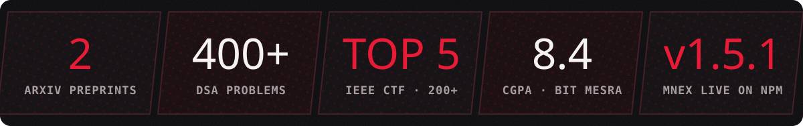

I build the parts that sit **between an LLM and a real system**: memory, state, audit trails,
and turning messy documents into **knowledge graphs you can query**. End to end, from
extension to worker to graph DB to UI. **Open to internships and new-grad roles.**

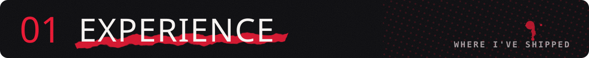
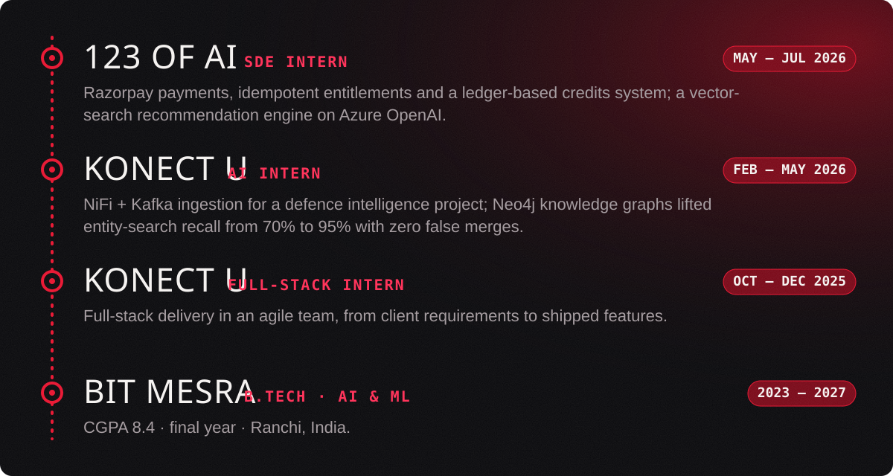

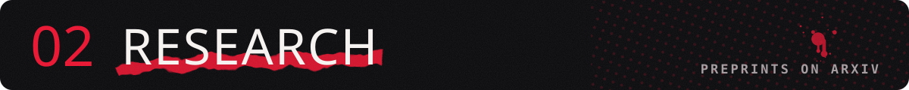
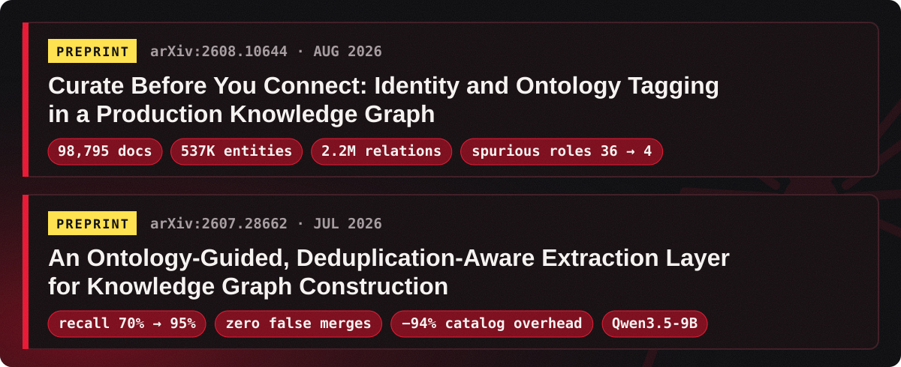

📄 <a href="https://arxiv.org/abs/2608.10644"><b>Curate Before You Connect</b></a> &nbsp;·&nbsp; <a href="https://arxiv.org/abs/2607.28662"><b>Ontology-Guided, Deduplication-Aware Extraction</b></a>

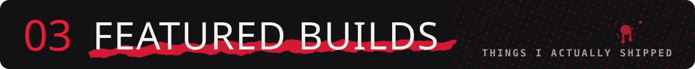

<table>
<tr>
<td width="50%"><a href="https://github.com/VaibhavDangaich/MNEX">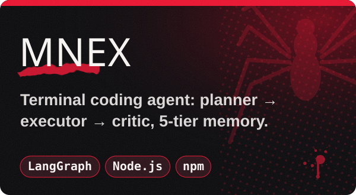</a></td>
<td width="50%"><a href="https://github.com/VaibhavDangaich/Orbit">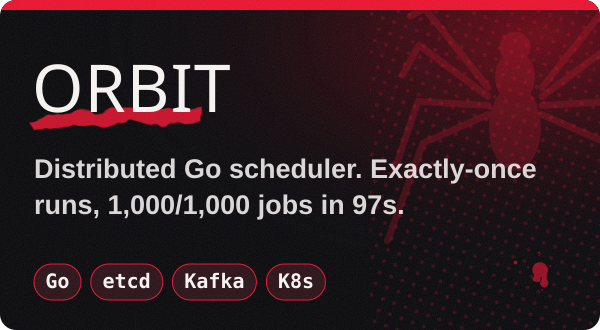</a></td>
</tr>
<tr>
<td width="50%"><a href="https://github.com/VaibhavDangaich/foiatlas">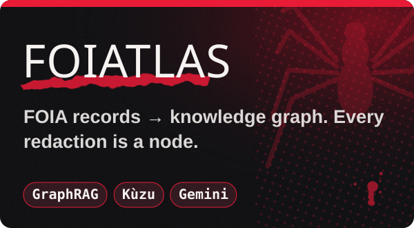</a></td>
<td width="50%"><a href="https://github.com/VaibhavDangaich/Codestreet_2026">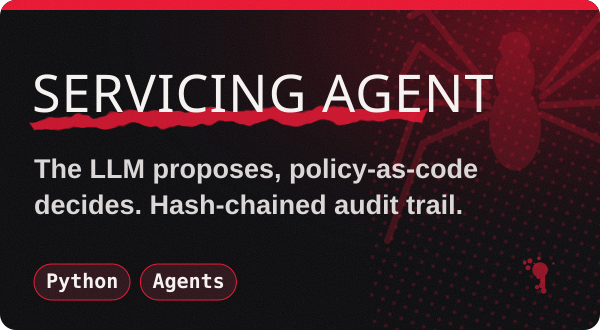</a></td>
</tr>
<tr>
<td width="50%"><a href="https://github.com/VaibhavDangaich/Context_graph">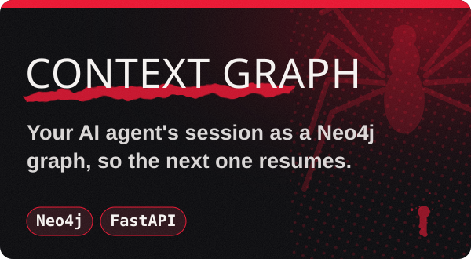</a></td>
<td width="50%"><a href="https://github.com/VaibhavDangaich/visual-activity-agent">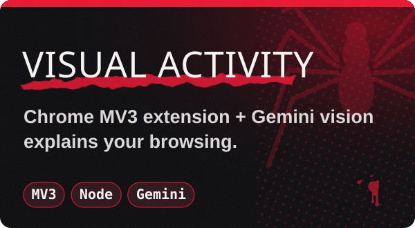</a></td>
</tr>
</table>

Also: <a href="https://github.com/VaibhavDangaich/Sagepilot">Order Supervisor</a> (durable AI supervisor on Temporal) · <a href="https://github.com/VaibhavDangaich/ai-commit-cli">PushMuse</a> (AI commit messages) · <a href="https://github.com/VaibhavDangaich/AI-resume-builder">AI Resume Builder</a> · <a href="https://foiatlas-499486403320.asia-southeast1.run.app">FOIAtlas live demo ↗</a>

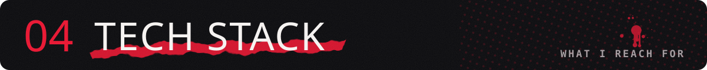

   
  

<b>AI &amp; graphs:</b> LangGraph · LangChain · Temporal · Ollama · Gemini · Azure OpenAI · Neo4j · Kùzu · vector search

<picture>
  <source media="(prefers-color-scheme: dark)" srcset="https://raw.githubusercontent.com/VaibhavDangaich/VaibhavDangaich/output/github-snake-dark.svg" />
  
</picture>

<a href="mailto:vaibhavdangaich@gmail.com">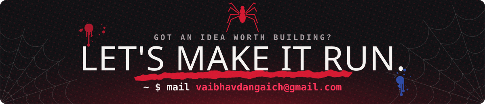</a>

